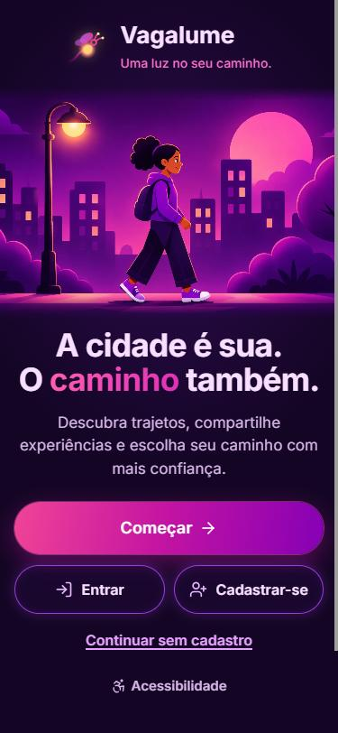
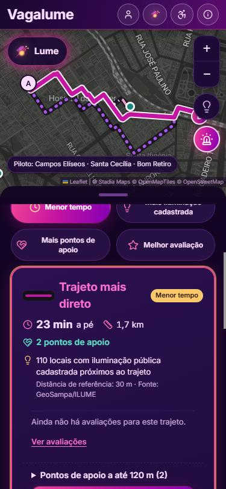
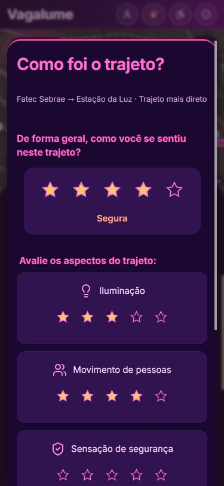
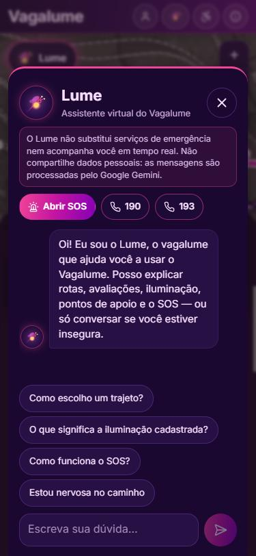
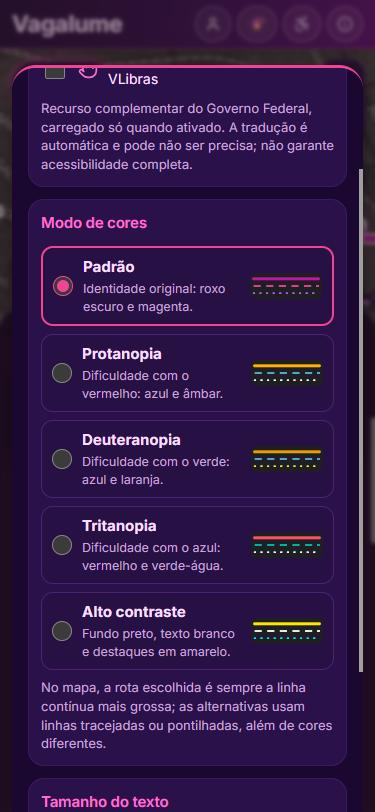
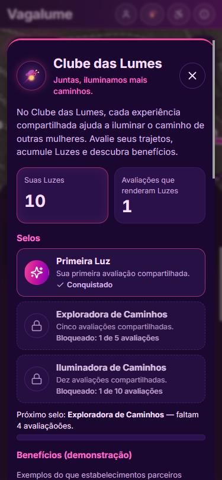

<h1 align="center">Vagalume</h1>

<strong>Uma luz no seu caminho.</strong>

  <a href="https://somosvagalume.vercel.app/">Acessar o aplicativo</a>

---

## Sobre

O **Vagalume** é um aplicativo web de rotas a pé que apoia os deslocamentos de mulheres pela cidade com informações colaborativas sobre os trajetos.

MVP acadêmico desenvolvido na Fatec, com região piloto nos bairros Campos Elíseos, Santa Cecília e Bom Retiro, em São Paulo (SP).

## Objetivo

Caminhar pela cidade, principalmente à noite ou em ruas pouco conhecidas, gera insegurança. Informações que ajudam a escolher um percurso, como iluminação, locais de apoio e experiências de outras pessoas, costumam estar dispersas.

O Vagalume reúne essas informações em um só lugar para que cada mulher escolha seu caminho com mais segurança de decisão e ajude outras mulheres compartilhando a própria experiência.

> O Vagalume não garante a segurança de nenhum percurso. Em situação de risco, ligue **190** (Polícia Militar) ou **180** (Central de Atendimento à Mulher).

## Funcionalidades

- **Rotas a pé:** até três alternativas de trajeto, com tempo, distância, iluminação pública cadastrada, pontos de apoio próximos e avaliações.
- **Navegação:** instruções passo a passo em texto e áudio.
- **Compartilhamento:** envio do trajeto para pessoas de confiança.
- **Avaliação colaborativa:** registro da experiência com iluminação, movimento e sensação de segurança.
- **SOS:** prepara uma mensagem de emergência no WhatsApp para contatos de confiança e oferece atalhos para 190 e 180.
- **Lume:** assistente virtual que explica o aplicativo e oferece uma conversa acolhedora.
- **Acessibilidade:** VLibras, modos para daltonismo, alto contraste e ajuste do tamanho do texto.
- **Clube das Lumes:** Luzes e selos como reconhecimento por avaliações (catálogo de benefícios demonstrativo).

## Tecnologias

- React e Vite
- Leaflet, OpenStreetMap e Stadia Maps
- Dados públicos de iluminação do GeoSampa
- Google Gemini (assistente Lume)
- VLibras
- Vercel

## Capturas de tela

| Tela inicial | Mapa e trajetos | Avaliação |
|:---:|:---:|:---:|
|  |  |  |

| Assistente Lume | Acessibilidade | Clube das Lumes |
|:---:|:---:|:---:|
|  |  |  |

| SOS |
|:---:|
|  |

## Uso de Inteligência Artificial

O Claude, da Anthropic, foi utilizado como ferramenta de apoio ao longo de todo o desenvolvimento do Vagalume, contribuindo para a engenharia de prompts, estruturação de soluções, desenvolvimento e aprimoramento de funcionalidades no front-end e back-end. Também atuou como apoio em UX/UI Design, auxiliando na concepção de interfaces, organização de componentes, experiência do usuário e definição de diretrizes visuais. Além disso, foi utilizado na análise de problemas e exploração de soluções técnicas. As decisões de produto, escolhas técnicas e validação dos resultados permaneceram sob responsabilidade da equipe.

## Equipe

- **Alessandra La Torre** — [GitHub](https://github.com/alesslatorre)
- **Matheus Bonfim** — [GitHub](https://github.com/MatheusBonfim265)
- **Fernanda Marques** — [GitHub](https://github.com/nanda-marques)
- **Manuella Santos** — [GitHub](https://github.com/Manuellasantos)
- **Mayra** — [GitHub](https://github.com/Cosmic-Bubble)
---

Vagalume · Uma luz no seu caminho.

  

